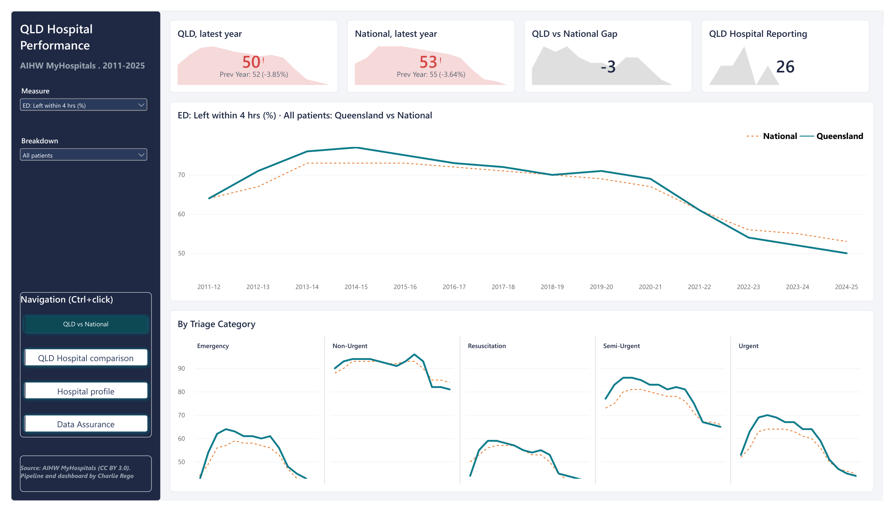
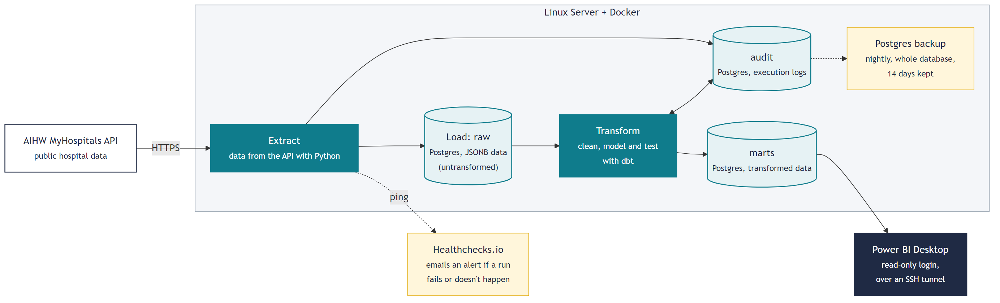
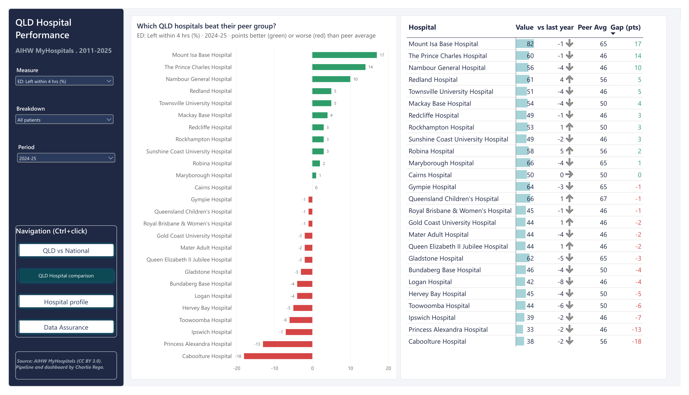

# Queensland Hospital Performance Pipeline

An automated, audited data pipeline that turns the AIHW's public hospital data into a Power BI dashboard comparing Queensland hospitals, including Toowoomba, with their peers.



## Why I built it

Public hospital data is only useful if people can trust it and it stays current. I wanted to show the full path from a public API to a decision-ready dashboard, with the controls an auditor would expect: every row accounted for, every run logged, and tests that fail loudly when something is wrong.

## Architecture



<sub>Diagram source: [`docs/images/architecture.mmd`](docs/images/architecture.mmd) (Mermaid).</sub>

Everything except Power BI runs in Docker on a small Ubuntu VPS in Sydney.

## How it works

1. **Ingestion (Python).** Every Monday at 03:00 AEST, cron runs the pipeline. It asks the AIHW MyHospitals API for the current data version and loads a measure category only if that version isn't already stored, so re-runs are safe and no-change weeks load 0 rows. Large categories are downloaded one measure at a time with retries (5, 15, 30, 60 s), and rows are streamed into Postgres with `COPY`.
2. **Raw → staging → marts (dbt).** Raw API records are kept unchanged as JSONB. dbt parses them into a staging model, then a star schema: `fct_hospital_measure` (862,030 rows) with `dim_reporting_unit` and `dim_measure`.
3. **Data-quality tests.** 23 dbt tests run on every build, including a three-way reconciliation. Results are written to `audit.dbt_results`.
4. **Audit trail.** Every run, load and test result is logged in an `audit` schema, including failed runs and partial progress.
5. **Dashboard.** Power BI Desktop reads the marts over an SSH tunnel as a read-only user (`powerbi_reader`).
6. **Monitoring and backups.** The run script pings Healthchecks.io on success or failure, and an email alert fires if a run fails or doesn't happen. A nightly `pg_dump` keeps 14 days of backups, and `scripts/restore_test.sh` restores the latest one into a temporary database and checks every table's row count and a checksum of the fact table against the live data.

## Data-quality controls

| Control | What it catches | What happens if it fails |
|---|---|---|
| Three-way reconciliation (API rows = raw rows = fact rows + quarantined duplicates) | Rows lost or invented anywhere between the source and the dashboard | Build fails, run marked `tests_failed`, Healthchecks alert |
| Unique and not-null keys on every model | Missing IDs, duplicate hospitals or measures, double-counted results | Build fails |
| Relationship tests (every fact links to a known hospital and measure) | Orphaned results that would silently drop out of the dashboard | Build fails |
| Percentages between 0 and 100; periods start before they end | Parsing errors and bad source values | Build fails |
| Duplicate source rows are quarantined, not dropped | Upstream duplicates | Warning: listed in the audit table, excluded from facts |
| Suppressed values must be blank | Misread suppression codes (this caught AIHW's "*" caution flag, see `docs/decisions.md`) | Warning |
| Run audit with partial progress | A failed run that loaded some data but reports 0 | Recorded in `audit.pipeline_runs` |

The dashboard's **Data Assurance** page shows the latest test results, the reconciled row count and the run history, including a real API timeout and the fix.

## Dashboard



`powerbi/qld-hospital-performance.pbix` is a **snapshot**. Power BI imports the data into the file, so it opens without a database connection. The date of the snapshot is shown on the Data Assurance page ("Last successful run"). A PDF export is in `powerbi/qld-hospital-performance.pdf` for anyone without Power BI.

Pages:

- **QLD vs National:** KPI cards and the long-run trend for the selected measure, with small multiples by triage category.
- **QLD Hospital comparison:** each Queensland hospital against its AIHW peer-group average for a chosen year (right-click a bar to drill through).
- **Hospital profile:** drill-through page, opens on Toowoomba Hospital: trend vs peers and every measure for the latest year.
- **Data Assurance:** latest dbt test results, row reconciliation (API = database) and pipeline run history.

Power BI features used: star-schema model, DAX measures (`CALCULATE`, `REMOVEFILTERS`, `ISINSCOPE`, `SELECTEDVALUE`), dynamic titles, field-value conditional formatting, drill-through, synced slicers, a Top N "latest year" filter and a custom theme (`powerbi/qld-hospital-theme.json`).

How the data stays current:

1. The Monday job loads any new AIHW release, rebuilds the models and runs the tests.
2. To update the snapshot, open the SSH tunnel and click **Refresh** in Power BI Desktop. Only the project owner can do this; anyone else who downloads the file sees the data as at the last refresh.
3. The `.pbix` is recommitted only when the dashboard itself changes, not after every weekly load.

More screenshots: [Hospital profile](docs/images/03-hospital-profile-toowoomba.png) · [Data Assurance](docs/images/04-data-assurance.png) · [Healthchecks monitor](docs/images/05-healthchecks.png)

## Key findings

Full write-up with caveats: [`docs/findings.md`](docs/findings.md).

1. **Toowoomba Hospital ED:** 44% of patients left within 4 hours in 2024-25, down from 66% in 2020-21 and 6 points below its peer group (Large regional hospitals, 50%).
2. **Time in ED:** Toowoomba's median time in ED rose from 189 to 272 minutes over the same period, now longer than Queensland (241) and Australia (228).
3. **Elective surgery is the brighter spot:** 98% of Toowoomba's urgent elective surgery patients were treated on time in 2024-25 (peers 91%).
4. **Across Queensland:** 11 of 26 hospitals beat their peer group on the 4-hour measure in 2024-25 and 14 fell short, from +17 points (Mount Isa) to -18 (Caboolture).

## Tech stack

Python (requests, psycopg) · PostgreSQL 17 · dbt · Docker / Docker Compose · cron · Power BI Desktop (DAX) · Healthchecks.io · Ubuntu VPS (Sydney)

## Repo layout

```
pipeline/     Python ingestion, orchestration and audit logging
dbt/          staging and marts models, schema tests, custom tests (dbt/tests)
db/init/      schemas, audit tables and the read-only Power BI user
scripts/      weekly run (run_pipeline.sh), nightly backup, restore test, ingest checks
powerbi/      dashboard (.pbix), PDF export and theme
docs/         decisions log, devlog, findings, screenshots
```

## Run it yourself

```bash
cp .env.example .env          # fill in the passwords (and optionally HEALTHCHECK_URL)
docker compose up -d db       # Postgres, initialised from db/init
./scripts/run_pipeline.sh     # download, load, dbt build + tests
```

The first full load downloads about 862,000 rows and takes roughly an hour. Later runs only load new AIHW releases.

## Limitations and next steps

- **Annual data.** Most measures are published once a year by financial year, so trends have about 14 points per hospital.
- **Suppression.** Small or unreliable values are suppressed by AIHW and appear blank.
- **Peer group labels.** The peer group stored on each hospital doesn't always match the group AIHW used for a measure's peer value, so the dashboard shows peer values without peer group names (see the data note in `docs/findings.md`).
- **One database login for the pipeline.** It's the container's owner account; in production I'd split owner, loader and reader roles.
- **No CI yet.** Tests run on the server; next I'd run `dbt build` against a test database on every push.
- **Manual dashboard refresh.** In production I'd publish to the Power BI service with an on-premises data gateway and schedule a refresh after each weekly load.
- **Live web dashboard (stretch).** A public, always-current dashboard on the server (for example a static site built from the marts after each Monday run), so anyone can view the latest data without Power BI.

## Data source and licence

Data: [AIHW MyHospitals API](https://www.aihw.gov.au/reports-data/myhospitals), Australian Institute of Health and Welfare, licensed under CC BY 3.0 AU. Code: Apache 2.0 (see `LICENSE`).

Built by Charlie Rego.
